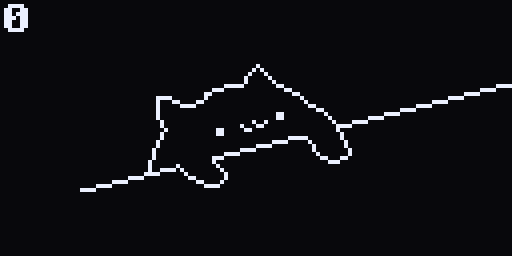
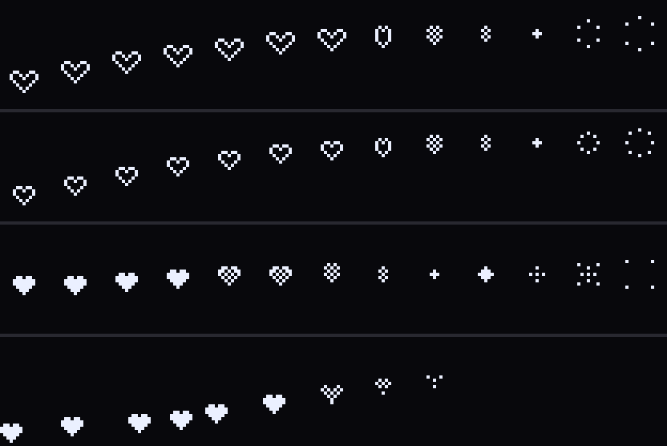
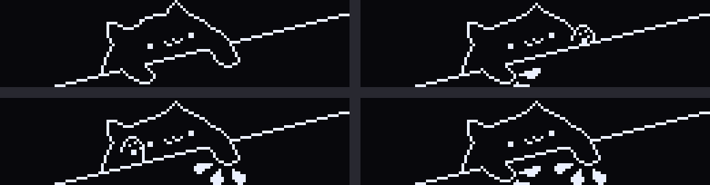

# Zephyr Bongo Cat

A Bongo Cat for an ESP32-C3 SuperMini with a 128×64 OLED. Press the left or right
key and the cat slaps the table, a heart pops up, and the counter in the top-left
corner goes up.

<p align="center">
  
</p>

- Single taps with either paw, or both paws at once
- Each tap spawns an animated heart
- After a period of inactivity it shows "Zzz", blanks the display, and enters deep sleep
- Press any key to wake it up; the waking press counts as a tap too
- The tap count is stored in flash (NVS), so it survives power loss

Built with Zephyr and LVGL, using [just](https://just.systems) for build and flash.

> The images in this README are rendered from the bitmap data in `src/bitmap.c`
> at 4× scale, so they show exactly what the firmware draws.

## Hardware

| Part                    | Pins                                   |
| ----------------------- | -------------------------------------- |
| ESP32-C3 SuperMini      |                                        |
| SH1106 OLED (I2C, 0x3C) | SDA = GPIO3, SCL = GPIO4               |
| Left key                | GPIO1 to GND (internal pull-up)        |
| Right key               | GPIO2 to GND (internal pull-up)        |

I2C runs at 400 kHz. Pins and display settings are in
`boards/esp32c3_supermini.overlay`.

## Requirements

- A west workspace (default `~/Projects/zephyrproject`, with a `.venv`)
  - Set `ZEPHYR_WORKSPACE` to use a different path
- Zephyr SDK
- `just` and `uv`

## Build and flash

First set `port` in `justfile` to your board's serial port
(`/dev/serial/by-id/...`).

```sh
just build        # build into ./build
just rebuild      # pristine rebuild
just config       # menuconfig
just flash        # flash the board
just monitor      # serial monitor
just upload       # build + flash
just run          # build + flash + monitor
just clean
```

Extra arguments are passed through to `west build`, e.g.
`just build -- -DCONFIG_APP_HEART_STYLE=2`.

## Configuration

| Option                             | Default | Description                                       |
| ---------------------------------- | ------- | ------------------------------------------------- |
| `CONFIG_APP_INACTIVITY_SLEEP_MS`   | 30000   | Idle time before powering off (ms)                |
| `CONFIG_APP_HEART_STYLE`           | 0       | Heart style 0–3 (only that style is compiled in)  |
| `CONFIG_APP_HEARTBEAT_INTERVAL_MS` | 1000    | Debug heartbeat log interval (ms)                 |

Set them in `prj.conf` or with `just config`.

### Heart styles

One row per style, 0 to 3 from top to bottom. Style 3 has 10 frames, the others have 13.

<p align="center">
  
</p>

## Cat poses

Idle, left paw, right paw, and both paws:

<p align="center">
  
</p>

## Project layout

```
.
├── CMakeLists.txt
├── Kconfig                         # app options (CONFIG_APP_*)
├── prj.conf                        # Kconfig settings
├── pm.conf / pm.overlay            # experimental light sleep
├── boards/
│   └── esp32c3_supermini.overlay   # display, I2C, keys
├── docs/images/                    # README images
├── include/
├── src/
│   ├── main.c      # main loop: LVGL, inactivity timer, power off
│   ├── button.c    # input callback -> message queue, wakeup key replay
│   ├── cat.c       # cat state machine (idle / prep / left / right / both)
│   ├── heart.c     # heart animation and tap counter
│   ├── storage.c   # tap count persistence (NVS on storage_partition)
│   └── bitmap.c    # all images, A1 format
├── zephyr.just     # shared recipes (board-agnostic)
└── justfile        # board, port, and flash settings for this project
```

> Note: when `boards/<board>.overlay` exists, Zephyr does **not** read `app.overlay`.

## Experimental: light sleep

```sh
just build-pm     # builds into ./build-pm, separate from the normal build
just flash-pm
```

The settings are in `pm.conf` and `pm.overlay`. On the ESP32-C3, light sleep
currently only wakes on the RTC timer, so key presses are handled at the next
timer wakeup, and the USB Serial/JTAG console may disconnect while sleeping.
